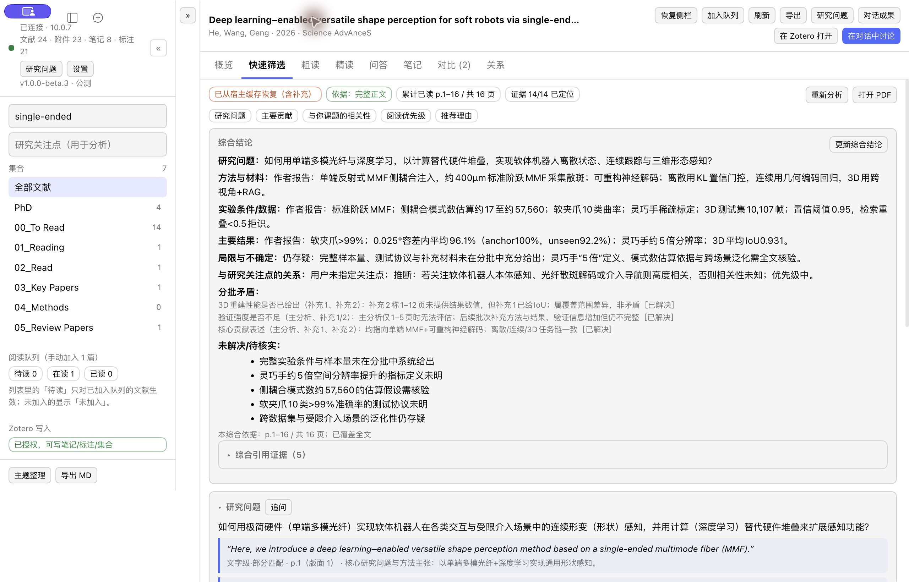
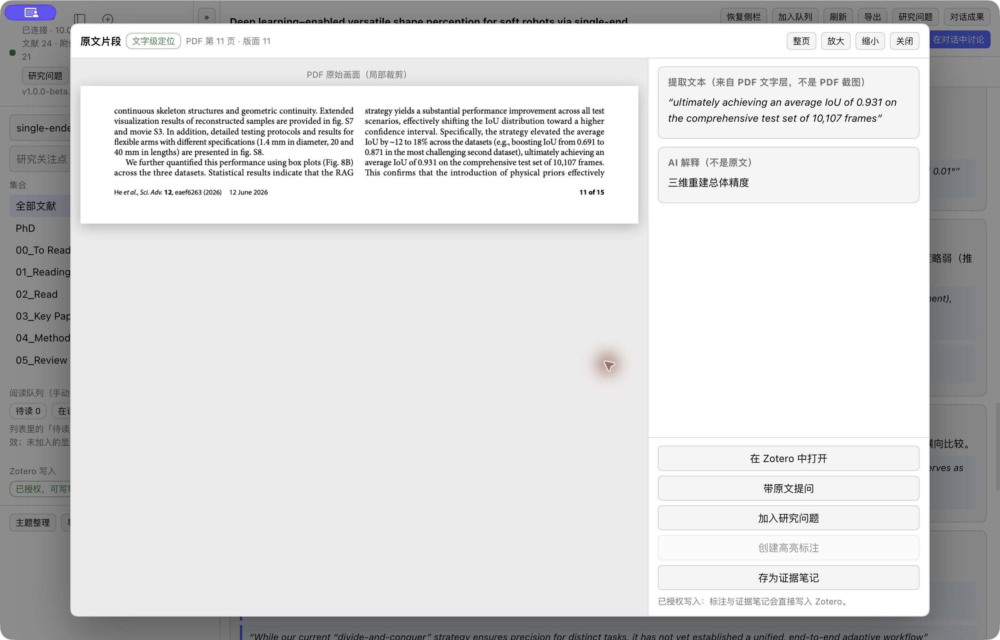
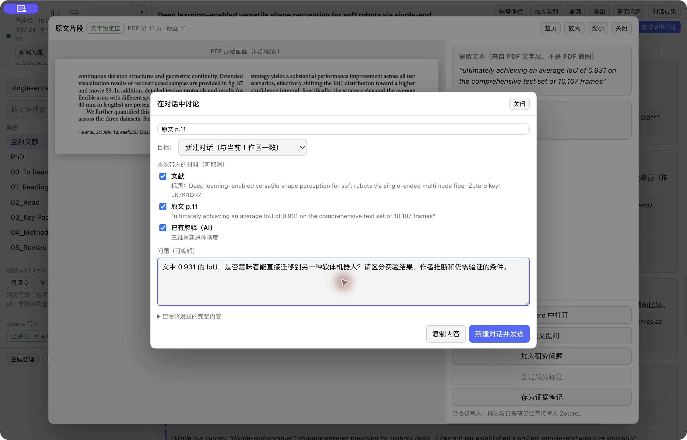

# Zotero Research

**Read Zotero papers in DeepSeek Harness. Keep the evidence, questions, and useful notes connected.**

[中文](README.md) · [Getting started](docs/GETTING_STARTED.md#english) · [Issues](https://github.com/ZhiyingLi-Leo/dsh-zotero-research/issues) · [Contributing](CONTRIBUTING.md)

Reading a paper is only part of the work. You still need to check its claims, question the method, compare related work, and keep notes you can use later. Zotero Research connects that workflow: **paper → layered reading → source evidence → conversation → notes and research questions**.

Package: `dsh-zotero-research`. Zotero manages the library and full PDF reading; Harness provides analysis and conversation.



*An actual reading session: results from multiple page ranges are combined while coverage, evidence, and unresolved questions remain visible.*

## From reading to understanding

| What you need | What the plugin provides |
|---|---|
| Decide what deserves attention | Search, thematic organization, a reading queue, priorities, and quick screening of questions and contributions |
| Understand methods and conclusions | Rough/deep reading, continuation across page ranges, synthesis, equations, figure conditions, limitations, and reproduction details |
| Check whether an answer has evidence | PDF excerpts and page references, separate source text and AI explanations, and opening the paper in Zotero |
| Follow a question further | Bring papers, sections, evidence, or annotations into real Harness conversations; compare papers and explore their relationships |
| Keep useful research progress | Save edited results to Zotero notes, or collect evidence, stances, understanding, and next steps around a research question |

## Follow a claim back to its source

Open an evidence card to compare the PDF excerpt, extracted quotation, and explanation. The preview is for checking a passage. Open Zotero for full reading and native highlights or comments.



## Continue the conversation with the right context

For example: **“Does this IoU result mean the method can transfer directly to another soft robot?”**

Choose the paper, quotation, and explanation to include, review the materials, then send them to a new or existing conversation. Edit and save useful results back to the paper, and connect evidence and conversations to an ongoing research question.



*Screenshots show a real reading session with a published paper. The conversation view shows the materials before sending.*

## Install

Requires **DeepSeek Harness `>=0.2.1-rc.5 <0.3.0`** and Zotero Desktop with its local API enabled.

Download the [prebuilt package](packages/dsh-zotero-research-1.0.0-beta.3.tgz) and install it into the Harness profile you use:

```sh
dsh plugin --profile <profile> add /path/to/dsh-zotero-research-1.0.0-beta.3.tgz
```

Restart Harness, open **Zotero → Settings**, check the connection, model, and write authorization, then select a paper.

npm distribution is being prepared. After publication, the command will be `dsh plugin --profile <profile> add dsh-zotero-research@beta`. See [Getting started](docs/GETTING_STARTED.md#english) for installation, upgrading from the old package, and removal.

## Platforms and data

- **macOS, Windows, and Linux** share PDF.js text extraction, page counting, and quote location.
- **PDF image preview** uses the optional macOS 13+ arm64 PDFKit helper. Other environments retain text evidence and Zotero opening.
- Writing notes, annotations, or collections requires Zotero authorization. Plugin records stay local and can be exported as Markdown or backed up as JSON; there is no cloud library sync.
- Model calls send the materials needed for the requested operation and may incur provider charges. The plugin does not upload the whole library in the background or send the Zotero authorization key or PDF file itself.

[Data and privacy](docs/GETTING_STARTED.md#data-and-privacy) · [CI and desktop acceptance](docs/ACCEPTANCE.md) · [Security](SECURITY.md)

## Contribute

Share reproducible issues, workflow ideas, and suggestions through [Issues](https://github.com/ZhiyingLi-Leo/dsh-zotero-research/issues). Build and contribution instructions are in [CONTRIBUTING.md](CONTRIBUTING.md).

MIT License · [LICENSE](LICENSE)
