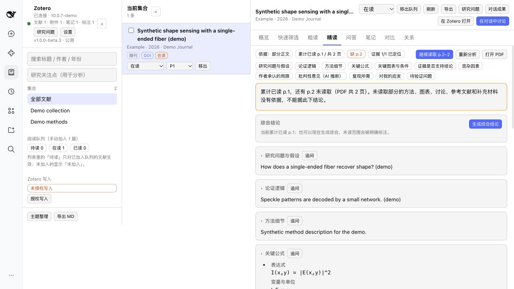
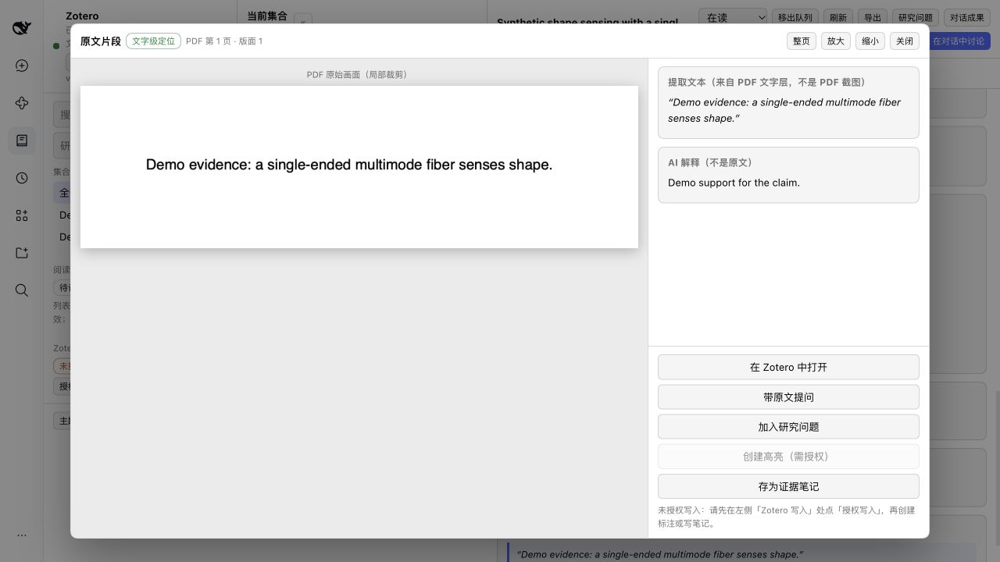
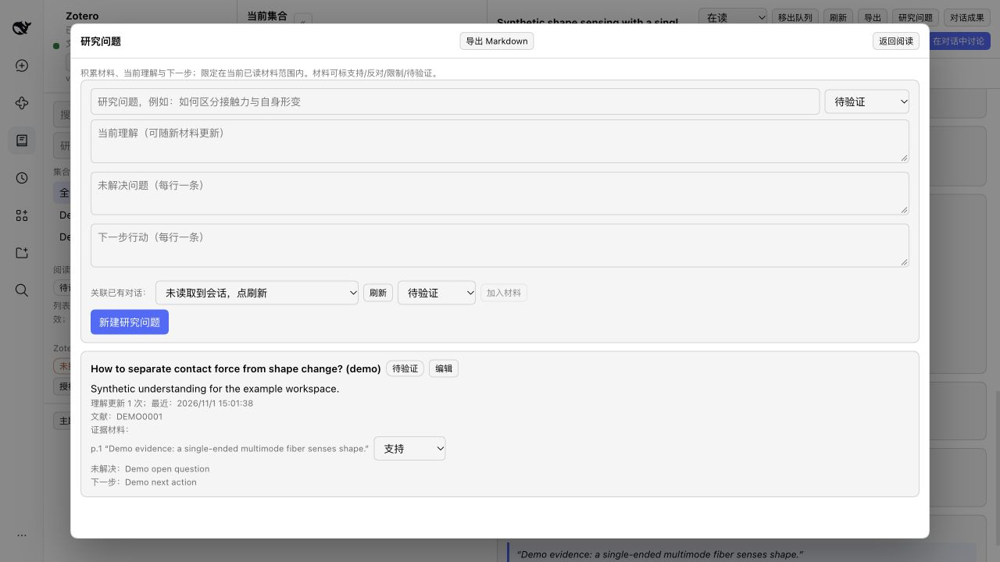

# dsh-zotero-research

**中文** | [English](README.en.md)

DeepSeek Harness 中的 Zotero 科研阅读工作台：分层阅读、证据核验、研究问题、对话衔接与成果写回。Zotero 负责完整 PDF 阅读与原生标注管理；本插件不是 Zotero XPI。

- 当前版本：**1.0.0-beta.3**
- 正式仓库：https://github.com/ZhiyingLi-Leo/dsh-zotero-research
- 安装包：`packages/dsh-zotero-research-1.0.0-beta.3.tgz`
- 未公开发布 npm 包，也未进入市场。

## 界面

*纯合成数据 / synthetic demo data*







截图来自独立演示 profile（合成 Zotero mock + 合成记录），不包含真实文献或笔记。捕获说明见 [demo/README.md](demo/README.md)。

## 功能

- 快速/粗读/精读分层结果，显示实际阅读页范围、缺页和“部分正文”依据。
- 统一综合结论，保留分批矛盾、未解决/待核实与可核对的原文证据。
- 证据局部/整页预览、定位级别标签、在 Zotero 打开；无法精确定位时只给页码。
- 研究问题工作区：材料立场、当前理解、未解决问题、下一步、理解演变。
- 与正式 Harness 对话衔接：文献、小节、证据、标注、多篇对比；材料可检查、可编辑。
- Zotero 笔记/标注读取与写回，带冲突保护；Markdown 导出（分析、分批、笔记来源、问答）。
- 插件数据备份/恢复：研究问题、组合分析、问答、队列；不含授权 key、设置与缓存。

## 平台能力

| 能力 | macOS arm64 | Windows | Linux |
|---|---|---|---|
| PDF.js 文字、页数、引文定位、PDF 坐标 | 支持 | 支持 | 支持 |
| PDFKit 图像渲染（证据裁剪） | 可选 helper（macOS 13+） | 使用文字证据 | 使用文字证据 |
| 在 Zotero 打开 | `open -a Zotero` | `rundll32 url.dll,FileProtocolHandler` | `xdg-open` |
| 旋转页精确写回 | 页面级，不写精确矩形 | 同左 | 同左 |

PDF 文字与坐标由 PDF.js 提供（三端同一实现）；图像预览是 macOS 的可选增强，缺失时不影响文字证据和 Zotero 跳转。真实 GUI/CI 验收边界见 [docs/ACCEPTANCE.md](docs/ACCEPTANCE.md)。

## 安装

本地包：

```sh
dsh plugin --profile <profile> add /absolute/path/dsh-zotero-research-1.0.0-beta.3.tgz
```

未来 npm（示例，尚未发布）：

```sh
dsh plugin --profile <profile> add @scope/dsh-zotero-research@beta
```

`npm install` 只把包加入 Node 项目，不会在 Harness profile 中激活插件；web 与 desktop 分别使用自己的 profile。

## 卸载

```sh
dsh plugin --profile <profile> remove dsh-zotero-research
```

## 升级（保留数据）

1. 先导出插件数据备份。
2. 正常退出 Harness。
3. 移除旧依赖：
   ```sh
   dsh plugin --profile <profile> remove dsh-zotero
   ```
4. 安装新包：
   ```sh
   dsh plugin --profile <profile> add /absolute/path/dsh-zotero-research-1.0.0-beta.3.tgz
   ```
5. 若 desktop profile 的 `cordis.patch.yml` 有手写旧层 `id/name: dsh-zotero`，仅替换该插件块为 `dsh-zotero-research`，保留其他插件和配置；不要让新旧两个块同时运行。
6. 重开 Harness。不要删除 `storages/zotero-plugin`。

旧存储目录、旧备份格式 `dsh-zotero-backup`、Zotero 标签 `dsh-zotero`/`dsh-zotero:ai`、localStorage 偏好键均保留兼容；没有自动迁移，恢复只合并不覆盖。

## 使用流程

1. 打开 Zotero 面板 → 设置：检查 Zotero/本地 API、模型、PDF 能力、写入授权。
2. 选择文献 → 快速/粗读/精读；预检显示模型、实际页范围与发送内容。
3. 点击证据查看原文片段；完整阅读或原生高亮时打开 Zotero。
4. 对结论/方法/局限追问，或带证据/标注进入正式对话。
5. 在研究问题中积累材料、更新理解，将成果保存回 Zotero 或导出 Markdown。

## 隐私与费用

- 只有点击分析/综合/对比/关系/提问时，才发送文献标题、作者、年份、来源、摘要、所选页正文、研究关注点与必要历史问答；带入笔记/标注/证据/综合时才会发送这些材料。
- 不发送 Zotero 授权 key、PDF 附件文件、密码或其他凭据；不含遥测或后台全库上传。
- 模型服务商保留策略由其自身政策决定，本插件不做未证实保证。
- 模型调用可能产生费用，插件不估算具体金额；对比最多 6 篇、关系最多 8 篇，发送前提示。

## 备份与恢复

设置 → 备份与恢复：导出插件数据 JSON（研究问题、组合分析、问答、队列）；预览冲突后按主键合并，只追加缺失记录和未见问答，不覆盖人工内容。备份不是 Zotero 原库/PDF 备份，不含正式会话正文、对比/关系结果、授权 key、设置或缓存。

## 开发

干净源码顺序（源码包不含生成的 `client/client.js`）：

```sh
pnpm install
node client/build.mjs
node scripts/check.mjs
node scripts/pack.mjs
node scripts/install-check.mjs
```

`scripts/pack.mjs` 优先使用 `DSH_PNPM`/`npm_execpath`/Harness 内置 pnpm JS 入口；Windows 会解析 `.CMD` shim 找到真正 pnpm JS 入口，仅在必要时用 `cmd.exe` 完整命令回退。合成演示见 [demo/README.md](demo/README.md)。

## 反馈与许可

- 反馈：`.github/ISSUE_TEMPLATE/bug_report.md`；安全：[SECURITY.md](SECURITY.md)；贡献：[CONTRIBUTING.md](CONTRIBUTING.md)。
- 验收边界：[docs/ACCEPTANCE.md](docs/ACCEPTANCE.md)。
- 许可证：MIT，见 [LICENSE](LICENSE)。

[English](README.en.md)
